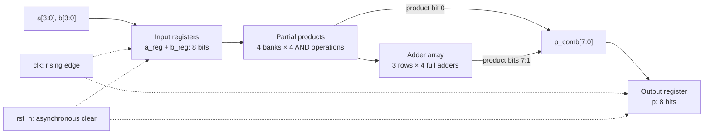

# 4-bit Array Multiplier · RTL to GDSII

**From Boolean equations to a chip layout on SkyWater's 130 nm process.**

This project implements an unsigned **4-bit × 4-bit multiplier** in Verilog and takes it through verification, standard-cell synthesis, static timing analysis, and physical design. The arithmetic is built explicitly from partial products and full adders. Its inputs and output are registered, and the finished layout uses the **SKY130A `sky130_fd_sc_hd`** library.

| Team member | Roll number |
|---|---|
| Vedant Zope | 2024102003 |
| Kavya Pandey | 2024102001 |

| Verification | Synthesis | Typical pre-route timing | Final physical design |
|---|---|---|---|
| All 256 input pairs pass | 70 cells; 16 flip-flops | ≈335.23 MHz estimated maximum | 150 × 150 µm die; 0 DRC / 0 LVS errors |

The timing estimate is a saved near-zero-slack boundary. The final physical run uses a 6.5 ns clock and has positive setup slack; remaining evidence and electrical limitations are explained below.

**Explore:** [Design and code](#how-the-multiplier-works) · [Repository map](#repository-map) · [Run the flow](#run-the-flow-in-assignment-order) · [Results](#results-and-what-they-mean)

## What is implemented

| Assignment part | Implementation | Main output |
|---|---|---|
| **A · Design and verify** | Structural multiplier, asynchronous reset, exhaustive self-checking testbench, waveform dump, deliberate-fault check | RTL PASS, fault FAIL, and `mult.vcd` |
| **B · Synthesize** | Yosys flattening and mapping into SKY130 cells; gate-level functional simulation | Mapped Verilog netlist and cell/area report |
| **C · Analyze timing** | OpenSTA constraints, maximum-delay report, critical-path analysis, frequency estimate | Register-to-register timing report |
| **D · Build the layout** | LibreLane flow through placement, clock-tree synthesis, routing, extraction, DRC and LVS | Final metrics and GDSII layout |

The delivered hardware has fixed 4-bit unsigned operands, an 8-bit product, 16 partial-product AND operations, 12 full-adder instances, and 16 register bits. It can accept a new operand pair on every clock cycle. The original testbench checks one pair at a time; an additional audit checks continuous streaming.

## How the multiplier works

### Interface and register timing

| Port | Direction | Width | Meaning |
|---|---|---|---|
| `clk` | Input | 1 | Rising-edge clock |
| `rst_n` | Input | 1 | Active-low asynchronous reset; clears input and output registers |
| `a` | Input | 4 | Unsigned multiplicand, 0–15 |
| `b` | Input | 4 | Unsigned multiplier, 0–15 |
| `p` | Output | 8 | Registered product, 0–225 |



In [`rtl/mult_array.v`](rtl/mult_array.v), one clocked block updates `a_reg`, `b_reg`, and `p` using nonblocking assignments. At **edge E1**, the input registers capture a new operand pair while `p` captures the previous pair's product. At **edge E2**, `p` captures the new pair's product. There are no registers between the adder rows.

The assignment calls these two capture edges a **two-cycle latency** and uses `latency = 2T` in its results tables. The elapsed time between E1 and E2 is one clock period. After the pipeline fills, the hardware produces **one result per cycle**; there is no enable or valid/ready handshake.

### The full adder: the smallest building block

[`rtl/full_adder.v`](rtl/full_adder.v) implements a one-bit full adder with continuous assignments:

```verilog
assign sum  = a ^ b ^ cin;
assign cout = (a & b) | (cin & (a ^ b));
```

`sum` is the low bit of `a + b + cin`; `cout` is the carry into the next bit. Four instances form each ripple-carry row. The synthesizable RTL uses no multiplication operator; `*` appears only in verification to calculate expected answers.

### Following the array row by row

Each `pp` bank computes `a_reg & {4{b_reg[i]}}`: four AND operations selecting either the registered multiplicand or zero. The row wiring accounts for the binary shifts without building four separate 8-bit adders.

| Row | RTL instances | Operation | Finished product bits / next-row input |
|---|---|---|---|
| 0 | Four AND operations; no adders | Form `pp0` | `p_comb[0] = pp0[0]`; `r0 = {1'b0, pp0[3:1]}` |
| 1 | `fa1_0` … `fa1_3` | Add `pp1` and `r0`, starting with carry 0 | `p_comb[1] = s1[0]`; `r1 = {c1[4], s1[3:1]}` |
| 2 | `fa2_0` … `fa2_3` | Add `pp2` and `r1`, starting with carry 0 | `p_comb[2] = s2[0]`; `r2 = {c2[4], s2[3:1]}` |
| 3 | `fa3_0` … `fa3_3` | Add `pp3` and `r2`, starting with carry 0 | `p_comb[3] = s3[0]`; `p_comb[7:4] = {c3[4], s3[3:1]}` |

Within each row, `c1`, `c2`, or `c3` carries a bit from one full adder to the next. Between rows, the lowest sum bit is already final, so the remaining sum bits and final carry form the next four-bit input. The report includes a diagram labeling all twelve full adders and the register banks.

### Worked example: 6 × 7 = 42

The assignment selects `A = last roll-number digit + 5`. Using **Kavya Pandey's 2024102001** gives `A = 6` and `B = 7`. The alternate `B = 9` rule applies only when `A = 7`.

```text
    00000110    A = 6
  × 00000111    B = 7
  ----------
    00000110    pp0      =  6
    00001100    pp1 << 1 = 12
    00011000    pp2 << 2 = 24
  + 00000000    pp3 << 3 =  0
  ----------
    00101010    P = 42
```

In the replay with an explicit nanosecond timescale, the operands are applied at **2076 ns**, captured at **2085 ns (E1)**, and produce `p = 42` at **2095 ns (E2)**. The checker samples at 2096 ns. The report annotates these two edges on the waveform; the original screenshot below uses seconds because the delivered testbench lacks a timescale directive.


## Repository map

The required submission files keep the assignment's exact names. Comments explain what to read or expect from each one.

```text
.
├── README.md                       Project guide, commands, attempts, and results
├── rtl/
│   ├── full_adder.v                 One-bit combinational full adder
│   └── mult_array.v                 Registered 4×4 structural multiplier
├── tb/
│   └── tb_mult.v                    Exhaustive 256-pair checker; writes mult.vcd
├── synth/
│   ├── synth.tcl                    Yosys synthesis and SKY130 mapping steps
│   ├── mult_array_netlist.v          Generated standard-cell implementation
│   └── mult_array_stat.rpt           Generated cell counts and area statistics
├── sta/
│   ├── sta.tcl                      OpenSTA setup; saved clock period: 2.983 ns
│   └── mult_array_timing.rpt         Saved maximum-delay paths and slack
├── pnr/
│   ├── config.json                  LibreLane settings; final clock: 6.5 ns
│   ├── metrics.json                 Final physical-design and signoff metrics
│   └── mult_array.gds               Final layout at the required filename
└── report/
    └── report.pdf                   Results, annotated figures, and Q1–Q6 answers
```


**Flow:** `full_adder.v` → `mult_array.v` → `tb_mult.v` → `synth.tcl` and its outputs → `sta.tcl` and its report → `config.json` and `metrics.json`.

## Run the flow in assignment order

The commands below follow assignment Sections 4 and 6–9 and the supplied scripts. They are a reproducible procedure; the complete original terminal history, container-launch command, run IDs, and final-copy commands were not supplied. Run Parts A–C from the **repository root** and Part D from **`pnr/`**.

### 1. Set up the tools and PDK

The assignment specifies the **IIC-OSIC-TOOLS Docker environment**, which bundles Icarus Verilog, GTKWave, Yosys, OpenSTA, LibreLane, OpenROAD, Magic, Netgen, KLayout, and SKY130. Follow the Quick launch instructions in the environment's README, open `http://localhost`, and use its terminal. Keep this repository in host `~/eda/designs`, mapped to `/foss/designs` inside the container. The assignment recommends at least **20 GB free disk space and 8 GB Docker RAM**; its troubleshooting guidance also recommends four CPUs.

Check the tools and PDK:

```bash
iverilog -V | head -1
yosys -V
sta -version
echo "$PDK_ROOT" "$PDK"
```

If SKY130A is not selected:

```bash
sak-pdk sky130A
```

Both Tcl scripts use the typical-corner Liberty file:

```text
$PDK_ROOT/sky130A/libs.ref/sky130_fd_sc_hd/lib/sky130_fd_sc_hd__tt_025C_1v80.lib
```

This corner is **25 °C, 1.8 V**. Gate-level simulation additionally needs `primitives.v` and `sky130_fd_sc_hd.v` in the library's `verilog/` directory.

### 2. Part A — Compile, simulate, and inspect the RTL

```bash
iverilog -g2012 -o sim tb/tb_mult.v rtl/full_adder.v rtl/mult_array.v
vvp sim
gtkwave mult.vcd
```

[`tb/tb_mult.v`](tb/tb_mult.v) holds reset low for the first two rising edges, loops through all `16 × 16 = 256` operand pairs, waits two rising edges for each pair, and compares the product after a further `#1` delay so register updates have settled. It prints every mismatch, then exactly one summary:

```text
PASS: 256 vectors checked, 0 errors
```

**Clock-unit caveat:** `always #5 clk = ~clk` creates a ten-unit period, but the delivered HDL has no explicit timescale. Use the existing replay helper for an explicit **10 ns** simulation and the assignment's intentional-fault experiment:

```bash
bash report/evidence/reproduce.sh
```

It runs the original files, adds a `1ns/1ps` compilation-unit directive for a second run, then changes `sum` to `a ^ b` in a temporary copy for the fault run. It preserves the delivered HDL and produces:

```text
PASS: 256 vectors checked, 0 errors
PASS: 256 vectors checked, 0 errors
FAIL: 256 vectors checked, 95 errors
```

Logs are written to `report/evidence/rtl-{original,normalized,fault}.log`. To inspect the waveform with nanosecond units and run the additional full-adder, streaming, and asynchronous-reset checks:

```bash
gtkwave report/build/verification/normalized/mult.vcd
bash report/evidence/audit-rtl.sh
```

### 3. Part B — Synthesize and simulate the mapped netlist

```bash
yosys -c synth/synth.tcl
```

[`synth/synth.tcl`](synth/synth.tcl) performs the required steps in order:

| Step | Yosys command | Purpose |
|---|---|---|
| 1 | `read_verilog rtl/full_adder.v rtl/mult_array.v` | Load both RTL modules |
| 2 | `synth -top mult_array -flatten` | Synthesize and flatten the full-adder hierarchy |
| 3 | `dfflibmap -liberty $lib` | Map register bits to library flip-flops |
| 4 | `abc -liberty $lib` | Map combinational logic to library cells |
| 5 | `opt_clean -purge` | Remove unused logic and wires |
| 6 | `tee -o synth/mult_array_stat.rpt stat -liberty $lib` | Save cell counts and areas |
| 7 | `write_verilog -noattr synth/mult_array_netlist.v` | Save the mapped netlist |

The script prefixes each command with `yosys`, as required for Yosys Tcl mode. Next, run the same checker against the mapped design and SKY130 functional models:

```bash
CELLS="$PDK_ROOT/sky130A/libs.ref/sky130_fd_sc_hd/verilog"
iverilog -g2012 -DFUNCTIONAL '-DUNIT_DELAY=#1' -o gls \
  tb/tb_mult.v "$CELLS/primitives.v" "$CELLS/sky130_fd_sc_hd.v" \
  synth/mult_array_netlist.v
vvp gls
```

The supplied [gate-level simulation screenshot](report/assets/gate-pass.jpeg) reports `PASS: 256 vectors checked, 0 errors`. This checks functional behavior after mapping; static timing analysis checks whether the circuit meets a clock target.

### 4. Part C — Find the timing limit

[`sta/sta.tcl`](sta/sta.tcl) loads the typical Liberty file and mapped netlist, links `mult_array`, creates `clk`, applies 1.0 ns input/output delays, and reports the worst maximum-delay paths. **The saved script uses 2.983 ns.** For the assignment's first run, change its clock period to **10 ns**. The required sequence is:

```tcl
set lib $::env(PDK_ROOT)/sky130A/libs.ref/sky130_fd_sc_hd/lib/sky130_fd_sc_hd__tt_025C_1v80.lib
read_liberty $lib
read_verilog synth/mult_array_netlist.v
link_design mult_array
create_clock -name clk -period 10 [get_ports clk]
set_input_delay 1.0 -clock clk [delete_from_list [all_inputs] [get_ports clk]]
set_output_delay 1.0 -clock clk [all_outputs]
report_worst_slack -max
report_checks -path_delay max -digits 3 > sta/mult_array_timing.rpt
```

Run the script:

```bash
sta sta/sta.tcl
```

Record the worst setup slack (**WNS**), then calculate:

```text
Tmin (ns) = 10 − WNS
Fmax (MHz) = 1000 / Tmin
Latency (assignment convention, ns) = 2 × Tmin
Throughput (million results/s) = Fmax
```

Preserve the first run's output. Set the script's period to the measured `Tmin` rounded to 0.01 ns and rerun:

```bash
sta sta/sta.tcl
```

Each invocation overwrites `sta/mult_array_timing.rpt`. The supplied report is from **2.983 ns**, with displayed `0.000 (VIOLATED)` slack; the original 10 ns report is absent. Its implied 10 ns slack is approximately +7.017 ns. Rounding down to 2.98 ns implies about −0.003 ns slack, so the saved boundary should not be described as positive-margin timing closure.

### 5. Part D — Place, route, and inspect the layout

The initial clock target must be `1.2 × Tmin`, rounded **up** to the next 0.5 ns. For the saved boundary:

```text
Initial period = 0.5 × ceil((1.2 × 2.983) / 0.5) = 4.0 ns
```

[`pnr/config.json`](pnr/config.json) retains the final successful target:

```json
{
  "DESIGN_NAME": "mult_array",
  "VERILOG_FILES": ["dir::../rtl/full_adder.v", "dir::../rtl/mult_array.v"],
  "CLOCK_PORT": "clk",
  "CLOCK_PERIOD": 6.5,
  "FP_SIZING": "absolute",
  "DIE_AREA": [0, 0, 150, 150]
}
```

To repeat the assignment's search, start with `CLOCK_PERIOD = 4.0`; use the saved value to repeat the final target. From the repository root:

```bash
cd pnr
librelane config.json
```

The assignment also permits `python3 -m librelane config.json`. LibreLane runs synthesis → floorplanning/power grid → placement → clock-tree synthesis → routing → parasitic extraction and signoff → GDSII. If setup timing fails, increase `CLOCK_PERIOD` by 0.5 ns, rerun, and record the attempt.

| Recorded attempt | Clock period | Recorded outcome |
|---|---|---|
| 1 | 4.0 ns | Failed timing |
| 2 | 4.5 ns | Failed timing |
| 3 | 5.0 ns | Failed timing |
| 4 | 5.5 ns | Failed timing |
| 5 | 6.0 ns | Failed timing |
| 6 | 6.5 ns | Passed |

This history comes from the supplied [trial notes](report/assets/physical-trial-notes.jpg); individual attempt logs and failing slacks are unavailable. The final configuration and metrics support the 6.5 ns result.

After a successful run, copy `final/metrics.json` and the final GDS from `pnr/runs/<date-time>/` to **`pnr/metrics.json`** and **`pnr/mult_array.gds`**. Locate the actual GDS filename in that run; the original run ID and source path are unavailable here. **Do not commit `runs/`**; the root `.gitignore` excludes it.

Still inside `pnr/`, open the layout:

```bash
klayout mult_array.gds
```

Capture a whole-die view and a zoomed view of cell rows and metal routing. Return to the repository root before running the report commands below:

```bash
cd ..
```

## Results and what they mean

### Part B · Synthesized size

Source: [`synth/mult_array_stat.rpt`](synth/mult_array_stat.rpt), checked against the mapped netlist.

| Metric | Result |
|---|---|
| Total cells | **70** |
| Flip-flops | **16** × `sky130_fd_sc_hd__dfrtp_1` |
| Combinational cells | **54** |
| Total cell area | **797.0144 µm²** |
| Flip-flop area | **400.384 µm²** |
| Flip-flop share of total area | **50.24%** |
| Three most-used cell types | `dfrtp_1`: 16; `nand2_1`: 10; `clkinv_1`: 6 |
| Gate-level simulation | **PASS: 256 vectors checked, 0 errors** — supplied screenshot |

The 16 AND operations and 12 full adders describe the RTL structure. Flattening, Boolean simplification, and library mapping turn them into 54 combinational cells, including NAND, XOR/XNOR, majority, and complex gates. A full adder can require several cells, and adjacent functions can merge. The 16 asynchronous-reset flip-flops each occupy 25.024 µm², explaining why registers take roughly half the area of this small design.

### Part C · Critical path and typical-corner timing

Source: [`sta/mult_array_timing.rpt`](sta/mult_array_timing.rpt) and the mapped register connections.

| Metric | Result |
|---|---|
| Worst slack at 10 ns | **≈+7.017 ns**, inferred; original run absent |
| Minimum-period boundary | **≈2.983 ns** |
| Estimated maximum frequency | **≈335.23 MHz** |
| Slack at the saved 2.983 ns period | **0.000 ns, marked VIOLATED** |
| Critical start point | `_109_` → `a_reg[1]` |
| Critical end point | `_107_` → `p[7]` |
| Cells on the critical path | **8 combinational; 10 including endpoint flip-flops** |
| Latency using assignment's `2Tmin` convention | **≈5.966 ns** |
| Throughput at the estimated boundary | **≈335.23 million results/s** |

The ordered register-to-register path is:

```text
_109_ (a_reg[1], dfrtp_1)
  → _054_ (a22o_1) → _055_ (and3_1) → _058_ (nor3_1)
  → _070_ (xnor3_1) → _071_ (and3_1)
  → _085_ (maj3_1) → _097_ (maj3_1) → _098_ (maj3_1)
  → _107_ (p[7], dfrtp_1)
```

The period boundary is approximately `0.396 ns clock-to-Q + 2.456 ns logic + 0.131 ns setup = 2.983 ns`. The eight mapped logic cells cross functions from **seven structural full adders**; the [functional mapping](report/evidence/critical-path-map.md) explains the merged boundaries. The assignment's `2N = 8` full-adder-delay estimate gives the expected scale, rather than a one-to-one count of mapped gates. The earlier `rst_n` recovery check in the report is a separate asynchronous path.

### Part D · Routed layout and signoff

Source: [`pnr/config.json`](pnr/config.json), [`pnr/metrics.json`](pnr/metrics.json), and parsed SKY130 cell references in the GDS.

| Metric | Result |
|---|---|
| Final clock target | **6.5 ns**, or **153.85 MHz** |
| Recorded attempts | **6** |
| Die area | **22,500 µm²** — 150 × 150 µm |
| Core area | **17,759.5 µm²** |
| Cells after standalone synthesis | **70** |
| Cells after place and route | **4,822**, including physical support cells |
| Added cell kinds | Decaps, fillers, taps, clock buffers, and timing-repair cells |
| Routed wirelength | **2,612 µm** |
| Worst setup slack across corners | **+0.499256 ns** |
| Worst hold slack across corners | **+0.118873 ns** |
| Estimated post-route maximum frequency, worst corner | **166.65 MHz** |
| Estimated post-route maximum frequency, maximum-extraction typical corner | **324.21 MHz** |
| Part C typical-corner maximum frequency | **≈335.23 MHz** |
| Final DRC errors | **0** — router, Magic, and KLayout |
| LVS errors | **0** |

The assignment's post-route calculation gives `1000 / (6.5 − 0.499256) = 166.65 MHz`. This is an estimate from the saved run, not a separately closed run at that frequency. Its worst setup corner is slow silicon at **100 °C and 1.6 V**, whereas Part C uses the typical corner. The typical post-route estimate of 324.21 MHz is about **3.29% below** Part C; the 166.65 MHz comparison includes both implementation effects and the slower corner.

**Why did 70 cells become 4,822?** Most of the final layout supports the physical implementation:

| Final GDS category | Count | Role |
|---|---|---|
| Decoupling cells (`decap_3`) | 4,214 | Local power-supply capacitance |
| Fillers (`fill_1`, `fill_2`) | 272 | Complete empty row segments |
| Well/substrate taps (`tapvpwrvgnd_1`) | 245 | Connect wells and substrate to supply rails |
| Timing-repair delay/buffer cells | 20 | Adjust timing; includes the reported hold-buffer subset |
| Clock-tree buffers (`clkbuf_16`) | 3 | Distribute the clock |
| Flip-flops (`dfrtp_2`) | 16 | Preserve the input/output register bits |
| Other combinational cells | 52 | Implement the remapped arithmetic logic |
| **Total** | **4,822** | Excludes GDS via references |

The JSON's `design__instance__count__stdcell = 336` subtotal includes taps and excludes 4,486 filler/decap instances. Removing taps as well leaves **91** logic, register, and buffer instances. LibreLane also remaps and resizes logic, so the physical design differs from standalone synthesis beyond inserted support cells.


DRC verifies geometry against fabrication rules such as spacing, width, and enclosure. LVS compares the circuit extracted from the layout against the intended netlist. Both report zero errors here. The saved metrics still list **11 maximum-slew violations at slow corners**; positive setup/hold slack and zero DRC/LVS errors do not establish that every electrical check is clean.
