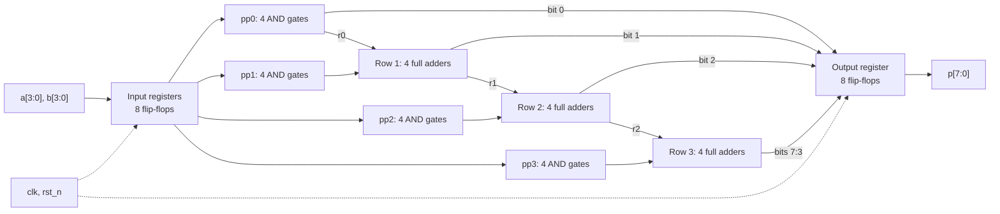

# 4-bit Array Multiplier: RTL to GDSII

A registered unsigned multiplier implemented in Verilog and taken through logic synthesis, static timing analysis, and physical design for the SkyWater 130 nm process using `sky130_fd_sc_hd` standard cells.

[Project assignment](<RTL_to_GDS doc.pdf>) · [Complete report](report/report.pdf) · [LaTeX sources and report instructions](report/README.md)

## Team

| Team member | Roll number |
|---|---|
| Vedant Zope | 2024102003 |
| Kavya Pandey | 2024102001 |

## Design

The top module, [`mult_array`](rtl/mult_array.v), captures the two operands in input registers, forms their product using a combinational array, and captures the result in an output register. [`full_adder.v`](rtl/full_adder.v) implements sum and carry with continuous assignments. The synthesizable RTL does not use the multiplication operator.

| Specification | Implementation |
|---|---|
| Operation | Unsigned 4-bit × 4-bit multiplication |
| Operand range | 0–15 for each input |
| Product | 8 bits; maximum value 225 |
| Partial products | 16 AND operations, arranged in four banks |
| Adder array | 12 full-adder instances: four in each of rows 1, 2, and 3 |
| Registers | 4 bits for `a_reg`, 4 for `b_reg`, and 8 for `p`: 16 flip-flops |
| Clock | Rising edge |
| Reset | Active-low asynchronous `rst_n`; clears all registers |
| Interface latency | Input capture at edge E1, output capture at E2 |
| Throughput | One result per cycle once the register stages are filled |

| Port | Direction | Width | Meaning |
|---|---|---|---|
| `clk` | Input | 1 | Clock |
| `rst_n` | Input | 1 | Asynchronous active-low reset |
| `a` | Input | 4 | Multiplicand |
| `b` | Input | 4 | Multiplier |
| `p` | Output | 8 | Registered product |



*Figure 1. RTL block diagram. The array has 16 AND operations and 12 full adders in total. Each adder row ripples its carry from bit 0 to bit 3; the upper three sums and final carry form the shifted bus for the next row. The report includes a diagram with all twelve instance names.*

The assignment calls E1/E2 capture a two-cycle latency and asks for latency values calculated as `2 × T`. There is one clock period between those two capture edges. This README retains the assignment's convention when giving latency in ns. The supplied testbench waits for both edges for every vector; it does not test a continuous one-pair-per-cycle input stream.

## Repository structure

```text
.
├── README.md
├── RTL_to_GDS doc.pdf
├── rtl/
│   ├── full_adder.v
│   └── mult_array.v
├── tb/
│   └── tb_mult.v
├── synth/
│   ├── synth.tcl
│   ├── mult_array_netlist.v
│   └── mult_array_stat.rpt
├── sta/
│   ├── sta.tcl
│   └── mult_array_timing.rpt
├── pnr/
│   ├── config.json
│   ├── metrics.json
│   └── mult_array.klayout.gds
├── pictures and results/             # 13 original images
├── report/
│   ├── report.pdf                    # completed two-column report
│   ├── main.tex
│   ├── sections/                     # editable report sections
│   ├── figures/                      # LaTeX block diagram
│   ├── assets/                       # identical images with simpler names
│   ├── evidence/                     # source snapshots, logs, VCD, helpers
│   ├── build-report.sh
│   ├── README.md
│   ├── REQUIREMENTS.md
│   ├── VALIDATION.md
│   └── rtl-to-gdsii-report-source.zip
└── .vscode/                          # LaTeX build and preview settings
```

The assignment requests `pnr/mult_array.gds`; the supplied layout is named [`pnr/mult_array.klayout.gds`](pnr/mult_array.klayout.gds). It is preserved under that name. For submission, a copy can be given the requested name:

```bash
cp pnr/mult_array.klayout.gds pnr/mult_array.gds
```

This is an optional submission preparation command, not a recorded original flow step. Generated `pnr/runs/` directories are not supplied and should not be committed, as required by the assignment. `report/build/` is ignored by the report's local `.gitignore`.

## Tools

| Tool or dependency | Purpose | Evidence or version information |
|---|---|---|
| Icarus Verilog and `vvp` | RTL and gate-level simulation | Original PASS screenshots; documentation recheck uses Icarus 12.0 |
| GTKWave | Inspect `mult.vcd` | Supplied waveform screenshot |
| Yosys | Flatten RTL and map SKY130 cells | Generated netlist header identifies Yosys 0.62 |
| OpenSTA | Standalone pre-route timing | Supplied Tcl script and timing report; original version unrecorded |
| LibreLane | RTL-to-GDSII flow | Supplied configuration, metrics, GDS, and run notes; original version unrecorded |
| OpenROAD | Placement, clock tree, routing, and extracted timing within the flow | Final metrics; original version unrecorded |
| KLayout, Magic, and Netgen | Layout viewing and physical verification | Layout images and DRC/LVS metrics; original versions unrecorded |
| SKY130A PDK, `sky130_fd_sc_hd` | Standard-cell models, timing, and physical data | Required by both Tcl scripts; exact original PDK revision unrecorded |
| Bash and Python 3 | Replay and result-extraction helpers | Python helpers use only the standard library |
| TeX Live, `latexmk`, and LaTeX Workshop | Build and preview the report | Existing report build script and VS Code configuration |

Icarus Verilog, GTKWave, and the report tools are available in the current WSL workspace. Yosys, OpenSTA, LibreLane, KLayout, Docker, and the original PDK are not available on the checked command path. Their existing outputs are analyzed here; a fresh complete physical-design run is not claimed.

## Setup

### Assignment environment

The assignment specifies IIC-OSIC-TOOLS with SKY130A, at least 20 GB free disk space, and at least 8 GB RAM for Docker. On Windows, enable WSL 2 and Docker's WSL integration. Install Docker for the host using the [IIC-OSIC-TOOLS setup guide](https://github.com/iic-jku/IIC-OSIC-TOOLS#4-quick-launch-for-designers).

For a fresh setup, run the following from this project's root in a host Bash terminal. `DESIGNS` mounts this checkout directly at `/foss/designs`:

```bash
export DESIGNS="$PWD"
git clone --depth=1 https://github.com/iic-jku/IIC-OSIC-TOOLS.git "$HOME/iic-osic-tools"
cd "$HOME/iic-osic-tools"
./start_vnc.sh
```

If the tools repository is already installed, use its existing directory instead of cloning again. Open the browser URL printed by the launcher. In the container's terminal, enter the project:

```bash
cd /foss/designs
```

These are documented setup instructions, not recovered original launch commands. The supplied simulation screenshots show a Nix-shell prompt. For an existing LibreLane/Nix installation, follow the [official newcomers' setup](https://librelane.readthedocs.io/en/latest/getting_started/newcomers/index.html); its shell can be entered with `nix-shell "$HOME/librelane/shell.nix"` if that checkout exists. The original environment revision is unknown.

### Check tools and PDK files

Run the stage commands below from the project root in the prepared EDA environment:

```bash
iverilog -V
yosys -V
sta -version
printf 'PDK_ROOT=%s\nPDK=%s\n' "$PDK_ROOT" "$PDK"
```

The assignment's container uses `sak-pdk sky130A` to select the PDK if it is not already selected. Both supplied Tcl scripts build their library path from `PDK_ROOT` and the literal `sky130A` directory. Check the required files before synthesis, gate simulation, or STA:

```bash
: "${PDK_ROOT:?Set PDK_ROOT to the directory containing sky130A}"
export PDK=sky130A
export SKY130_LIB="$PDK_ROOT/sky130A/libs.ref/sky130_fd_sc_hd/lib/sky130_fd_sc_hd__tt_025C_1v80.lib"
export CELLS="$PDK_ROOT/sky130A/libs.ref/sky130_fd_sc_hd/verilog"
test -r "$SKY130_LIB"
test -r "$CELLS/primitives.v"
test -r "$CELLS/sky130_fd_sc_hd.v"
```

These are the library/model filenames specified by the assignment and used by the project scripts or simulation screenshot. They cannot be checked locally without the PDK; use the matching installed PDK layout rather than substituting an unverified absolute path.

## Running the flow

The supported order is **RTL simulation → synthesis → gate-level simulation → standalone STA → physical design → layout inspection**. The commands below match the supplied scripts and simulation images. The LibreLane invocation comes from the assignment and supplied configuration. There is no complete original shell history, container tag, or individual physical-run command log, so this is a reproducible sequence rather than a claim to reconstruct every original keystroke. Rerunning stages regenerates their corresponding outputs.

### Part A: RTL verification

The original compile, simulate, and waveform commands are:

```bash
iverilog -g2012 -o sim tb/tb_mult.v rtl/full_adder.v rtl/mult_array.v
vvp sim
gtkwave mult.vcd
```

The testbench in [`tb/tb_mult.v`](tb/tb_mult.v) holds reset low for the first two rising edges, checks all 256 `(a,b)` pairs, waits for two capture edges, and samples one simulation unit later. It compares `p` with `i * j` using case inequality, prints every mismatch, prints one final summary, and writes `mult.vcd`.

The original testbench has no explicit timescale: `#5` produces a 10-unit clock, but the original VCD and screenshot label the units as seconds. The intended 10 ns period is reproduced by the existing helper using a separate compilation-unit `` `timescale 1ns/1ps `` directive. The helper also injects the required `sum = a ^ b` fault into a temporary copy, leaving the delivered RTL unchanged:

```bash
bash report/evidence/reproduce.sh
```

| Check | Measured summary | Evidence |
|---|---|---|
| Original RTL | `PASS: 256 vectors checked, 0 errors` | [Replay log](report/evidence/rtl-original.log) and supplied screenshot |
| RTL with explicit ns timescale | `PASS: 256 vectors checked, 0 errors` | [Normalized replay log](report/evidence/rtl-normalized.log) |
| Temporary faulty full-adder sum | `FAIL: 256 vectors checked, 95 errors` | [Full mismatch log](report/evidence/rtl-fault.log) |

The helper writes temporary simulation files under `report/build/verification/` and refreshes the replay logs under `report/evidence/`. For example, the injected fault changes the result of `3 × 3` from 9 to 5, demonstrating that the checker detects the lost carry-in term. During README verification, these commands were rerun in a temporary copy so the existing project artifacts stayed unchanged.


*Figure 2. Supplied RTL simulation output. All 256 vectors pass; the `(1s)` suffix reflects the original missing timescale.*

#### Roll-number example

Kavya Pandey's roll number is **2024102001**. Its last digit is 1, so the assignment example uses `A = 1 + 5 = 6` and `B = 7`. The `A = 7` exception is not needed.

```text
  00000110       A = 6
× 00000111       B = 7
----------
  00000110       partial product for b[0]
  00001100       partial product for b[1], shifted by 1
  00011000       partial product for b[2], shifted by 2
  00000000       partial product for b[3], shifted by 3
----------
  00101010       P = 6 + 12 + 24 = 42
```


*Figure 3. Original GTKWave screenshot showing `clk`, `rst_n`, `a`, `b`, and `p`. The screenshot's seconds labels are preserved. The [report](report/report.pdf) includes an enlarged crop with E1/E2 capture edges marked.*

| Event | Original screenshot time units | Normalized replay time |
|---|---|---|
| Apply `a=6, b=7`; previous product is 36 | 2076 | 2076 ns |
| E1: input registers capture 6 and 7 | 2085 | 2085 ns |
| E2: output changes to 42 | 2095 | 2095 ns |
| Testbench confirms the product | 2096 | 2096 ns |

The normalized [VCD](report/evidence/rtl-normalized.vcd) and [extracted events](report/evidence/example-events.json) preserve the example's timing evidence. `rst_n` is high in this example window; reset initialization is checked separately by reading the testbench and replay waveform.

### Part B: synthesis and gate-level verification

```bash
yosys -c synth/synth.tcl
```

[`synth.tcl`](synth/synth.tcl) runs `read_verilog`, `synth -top mult_array -flatten`, `dfflibmap`, `abc`, `opt_clean -purge`, `stat -liberty`, and `write_verilog -noattr`. It produces [`mult_array_stat.rpt`](synth/mult_array_stat.rpt) and [`mult_array_netlist.v`](synth/mult_array_netlist.v).

Compile the mapped netlist with the same testbench and the two PDK model files:

```bash
export CELLS="$PDK_ROOT/sky130A/libs.ref/sky130_fd_sc_hd/verilog"
iverilog -g2012 -DFUNCTIONAL '-DUNIT_DELAY=#1' -o gls \
  tb/tb_mult.v "$CELLS/primitives.v" "$CELLS/sky130_fd_sc_hd.v" \
  synth/mult_array_netlist.v
vvp gls
```

| Part B metric | Result |
|---|---|
| Total cells | 70 |
| Flip-flops | 16 × `sky130_fd_sc_hd__dfrtp_1` |
| Combinational logic cells | 54 |
| Total cell area | 797.0144 µm² |
| Flip-flop area | 400.384 µm² = 16 × 25.024 µm² |
| Flip-flop area fraction | 50.24% |
| Three most-used cell types | `dfrtp_1`: 16; `nand2_1`: 10; `clkinv_1`: 6; all use the `sky130_fd_sc_hd__` prefix |
| Gate-level simulation | `PASS: 256 vectors checked, 0 errors` in the supplied screenshot |

Synthesis flattens and optimizes the adder logic, so the 54 mapped logic cells are not simply the 16 AND operations plus 12 preserved full-adder macros. The 16 input/output flip-flops occupy roughly half the area because the combinational multiplier is small.


*Figure 4. Supplied mapped-netlist simulation. The mixed-timescale warning limits interpretation of absolute simulation time. The result supports functional verification at the testbench sampling points; it is not a post-route delay simulation. This stage was not rerun here without the PDK models.*

### Part C: static timing analysis

```bash
sta sta/sta.tcl
```

[`sta.tcl`](sta/sta.tcl) uses the typical `tt_025C_1v80` library, a **2.983 ns** clock period, 1.0 ns input delays on all non-clock inputs, and 1.0 ns output delays. It reads the mapped netlist and writes [`mult_array_timing.rpt`](sta/mult_array_timing.rpt). This standalone analysis uses an ideal clock and no extracted routed parasitics.

| Part C metric | Result and evidence status |
|---|---|
| Worst setup slack at a 10 ns period | Approximately +7.017 ns, inferred from the preserved path; original 10 ns log absent |
| Minimum-period boundary | Approximately 2.983 ns |
| Pre-route typical `Fmax` | Approximately 335.23 MHz |
| Saved slack at 2.983 ns | Displayed as `0.000 (VIOLATED)`; rounded near-zero boundary |
| Slack at the assignment's 0.01 ns rounded period, 2.98 ns | Approximately −0.003 ns, inferred; not a new measured run |
| Critical start | `_109_`: `a_reg[1]` |
| Critical end | `_107_`: `p[7]` |
| Critical-path cells | 8 combinational cells; 10 including endpoint flip-flops |
| Latency, assignment convention `2 × Tmin` | Approximately 5.966 ns |
| Throughput at that boundary | Approximately 335.23 million results/s, from one result/cycle |

The period estimate is `0.396 ns clock-to-Q + 2.456 ns logic + 0.131 ns setup = 2.983 ns`; `Fmax = 1000 / 2.983 = 335.23 MHz`. The secondary timing-note picture reports 335.57 MHz by taking the reciprocal of the rounded 2.98 ns. This README uses the preserved report's precision and does not describe the boundary as positive-margin timing closure.

The critical setup path is the `Path Group: clk` block, not the earlier reset-recovery path. Cells appear in this order; types omit the common `sky130_fd_sc_hd__` prefix:

| Position | Instance | Type | Incremental delay |
|---|---|---|---|
| Launch register | `_109_` | `dfrtp_1` | 0.396 ns clock-to-Q |
| 1 | `_054_` | `a22o_1` | 0.248 ns |
| 2 | `_055_` | `and3_1` | 0.181 ns |
| 3 | `_058_` | `nor3_1` | 0.276 ns |
| 4 | `_070_` | `xnor3_1` | 0.453 ns |
| 5 | `_071_` | `and3_1` | 0.209 ns |
| 6 | `_085_` | `maj3_1` | 0.361 ns |
| 7 | `_097_` | `maj3_1` | 0.379 ns |
| 8 | `_098_` | `maj3_1` | 0.349 ns |
| Capture register | `_107_` | `dfrtp_1` | Approximately 0.131 ns setup requirement |

These gates implement functions associated with seven structural full adders after optimization; the [functional mapping](report/evidence/critical-path-map.md) explains the trace. Eight mapped gates are not eight identical full-adder delays, although the assignment's `2N = 8` estimate gives the expected structural scale.

The assignment also requires a run at 10 ns and another near `Tmin`. The supplied script retains only the 2.983 ns setting. To repeat that search, change the `create_clock` period in a working copy, rerun STA, and preserve each report. A 10 ns or rounded 2.98 ns result must not be claimed as measured from the existing file.

### Part D: physical design

The final [`pnr/config.json`](pnr/config.json) contains:

```json
{
  "DESIGN_NAME": "mult_array",
  "VERILOG_FILES": ["dir::../rtl/full_adder.v", "dir::../rtl/mult_array.v"],
  "CLOCK_PORT": "clk",
  "CLOCK_PERIOD": 6.5,
  "FP_SIZING": "absolute",
  "DIE_AREA": [0, 0, 150, 150]
}
```

Run the assignment's flow invocation in the configuration directory:

```bash
(
  cd pnr
  librelane config.json
)
```

If the environment exposes LibreLane only as a Python module, the assignment permits `python3 -m librelane config.json` inside `pnr/`. Neither invocation was rerun during documentation work. The fixed 150 µm × 150 µm die is needed for this small design. LibreLane performs synthesis, floorplanning/power-grid generation, placement, clock-tree synthesis, routing, extraction, and signoff checks before producing GDSII.

New runs create output directories under `pnr/runs/`. The assignment asks for the final metrics and GDS to be copied into `pnr/`; exact final subpaths depend on the installed flow version. The supplied `metrics.json` and GDS are already present, but their original run directory and copy commands are not recorded. Preserve the final metrics, GDS, complete command, target period, and pass/fail log for each future attempt.

#### Physical run history

The assignment's initial target is `1.2 × Tmin`, rounded **up** to a 0.5 ns step: `1.2 × 2.983 = 3.5796 ns → 4.0 ns`. The supplied trial-history image records all six attempts available in the evidence:

| Attempt | Clock period | Recorded result |
|---|---|---|
| 1 | 4.0 ns | Failed timing |
| 2 | 4.5 ns | Failed timing |
| 3 | 5.0 ns | Failed timing |
| 4 | 5.5 ns | Failed timing |
| 5 | 6.0 ns | Failed timing |
| 6 | 6.5 ns | Passed |


*Figure 5. Informal run notes support the six-attempt count and 0.5 ns increments. Individual run IDs, exact commands, failure slacks, and failing corners are unavailable. The final 6.5 ns result is also supported by the configuration and metrics.*

#### Physical results

| Part D metric | Result |
|---|---|
| Final `CLOCK_PERIOD` | 6.5 ns; target frequency 153.85 MHz |
| Recorded attempts | 6, from the trial-history image |
| Die area | 22500 µm² |
| Core area | 17759.5 µm² |
| Cells after standalone synthesis | 70 |
| Cells after place and route | 4822 total SKY130 cell instances |
| Added kinds | Decap, filler, tap, timing-repair, and clock-tree cells |
| Final routed wirelength | 2612 µm |
| Worst setup slack, all reported corners | +0.499256 ns |
| Worst hold slack, all reported corners | +0.118873 ns |
| Estimated post-route `Fmax`, worst corner | 166.65 MHz |
| Part C `Fmax`, typical corner | Approximately 335.23 MHz |
| DRC errors | Router 0; Magic 0; KLayout 0 |
| LVS errors | 0 |
| Remaining electrical violations | 11 maximum-slew violations in slow-corner entries |

The values above come from [`pnr/metrics.json`](pnr/metrics.json), the configuration, and the trial notes. In particular, use `timing__setup__ws` for the positive worst setup slack; `timing__setup__wns` is zero when there are no negative setup slacks. `route__wirelength` is the final routed value, rather than the estimated or global-route wirelength.

```text
Post-route period estimate = 6.5 - 0.499256 = 6.000744 ns
Post-route Fmax estimate   = 1000 / 6.000744 = 166.65 MHz
```

This is an estimate from the 6.5 ns run, not a separately closed run at 6.000744 ns. The overall worst setup corner is `max_ss_100C_1v60` (slow, 100 °C, 1.6 V). The apparent reduction from 335.23 MHz to 166.65 MHz therefore includes a corner change as well as physical implementation effects. At `max_tt_025C_1v80`, final setup slack is +3.415555 ns, giving a more comparable typical estimate of **324.21 MHz**, about 3.29% below Part C.

The instance classes and GDS references give this breakdown. Cell types omit `sky130_fd_sc_hd__`:

| Final category | Instances | Purpose |
|---|---|---|
| Decaps, `decap_3` | 4214 | Local supply capacitance |
| Fillers, `fill_1` / `fill_2` | 272 = 211 + 61 | Complete otherwise empty row segments |
| Taps, `tapvpwrvgnd_1` | 245 | Well/substrate supply connections |
| Timing-repair cells | 20: 19 `clkdlybuf4s25_1` and 1 `dlygate4sd3_1` | Adjust timing; the separately reported hold-buffer count of 1 is a subset |
| Clock-tree buffers, `clkbuf_16` | 3 | Clock distribution |
| Flip-flops, `dfrtp_2` | 16 | Input and output registers |
| Other combinational cells | 52 | Optimized multiplier logic |
| **Total** | **4822** | Categories counted once |

The metric's 4486 `fill_cell` instances comprise both decaps and fillers. Its 336 `stdcell` subtotal includes 245 taps; removing those leaves 91 logic/register/buffer instances. Thus 4822 should not be compared with 70 as if both counted only functional arithmetic. Via references in GDS are excluded from these cell counts. Physical optimization also changes the combinational count and register drive strength relative to the standalone synthesis netlist.

DRC checks fabrication geometry rules; LVS checks extracted devices and connectivity against the intended circuit. Both report zero errors here. Positive setup/hold slack and zero DRC/LVS errors meet the assignment's stated pass conditions, but the 11 slow-corner slew violations mean every electrical check is not clean. The same slew count appears at multiple extraction corners and should not be added as if each entry were a different set of failing nets.

#### Inspect the layout

```bash
klayout pnr/mult_array.klayout.gds
```


*Figure 6. Supplied whole-die view with core rows, peripheral pins, and scale bar for the 150 µm square layout.*


*Figure 7. Supplied closer view of cell rows and routed geometry. Original layer hatching and labels limit the readability of individual wires; exact counts come from the metrics and GDS, not visual guesses.*

An [alternate supplied whole-die view](report/assets/layout-alternate.jpeg) shows different visible layers and is also included in the report.

## Reproduce result extraction and build the report

The existing result helper counts mapped-netlist cells, parses top-level GDS cell references, checks totals against the metrics, and calculates area/frequency values:

```bash
python3 report/evidence/extract_results.py
```

It refreshes [`extracted-results.json`](report/evidence/extracted-results.json). The [asset manifest](report/evidence/asset-manifest.json) records original filenames, evidence roles, and hashes for the preserved project inputs and images. Six pictures containing explanatory prose or prefilled tables are reference commentary; values in this README are checked against the underlying project reports.

To compile the report:

```bash
bash report/build-report.sh
```

The build script produces the preview at `report/build/main.pdf` and updates the submission file [`report/report.pdf`](report/report.pdf). Open [`report/main.tex`](report/main.tex) in the configured VS Code workspace and press **Ctrl+Alt+V** for a PDF preview on the right. Saving rebuilds that preview; run the build script to refresh the submission copy after edits. See the preserved [report README](report/README.md) for the source-file map and [LaTeX Workshop's viewer documentation](https://github.com/James-Yu/LaTeX-Workshop/wiki/View) for navigation shortcuts.

The report contains the required Part A–D tables, annotated waveform, twelve-adder diagram, worked example, layout screenshots, and all six answers from assignment Section 10. Its [requirements checklist](report/REQUIREMENTS.md) and [validation record](report/VALIDATION.md) remain available.

## Documentation requirements and coverage

The assignment prescribes the root filename and documentation contents, but no README heading template. The following maps its explicit documentation requirements to this file:

| Assignment requirement | Coverage | Evidence limit |
|---|---|---|
| Sections 5 and 11: root `README.md` | This file; [repository structure](#repository-structure) | Existing report documentation is preserved |
| Sections 5 and 11: both names and roll numbers | [Team](#team) | Full identities provided by the team |
| Sections 5 and 11: exact commands for every step, in order | [Setup](#setup), [running the flow](#running-the-flow), and report commands | Reproducible commands are provided; the full original setup/run/copy history is missing |
| Section 9: record every timing attempt, increasing by 0.5 ns | [Physical run history](#physical-run-history), all six documented attempts | Informal image available; individual run logs absent |
| Sections 5 and 9: required files and final outputs | Structure, artifact links, report, and GDS filename note | Original GDS has a different suffix; optional submission copy command provided |
| Sections 9 and 11: keep the large run directory out of submission | Structure and physical-flow instructions | No `runs/` directory is supplied |
| Section 13: explain and validate submitted work; show 4–5 meaningful progress commits | Design/results discussion, replay evidence, and existing Git history | History contains Part A–D commits; it does not establish a two-week development span |

## Limitations and missing information

- **Original command history:** simulation commands are visible in screenshots, and stage invocations match the supplied scripts. Original container/Nix setup commands, version pins, run IDs, and final-artifact copy commands are unavailable. The report's missing-root-README note describes the original supplied snapshot; this README is subsequent documentation.
- **Available attachments:** the extracted project folders and all 13 pictures are present. The original project/pictures ZIP containers were unavailable for checking their archive manifests.
- **Verification scope:** exhaustive simulation checks arithmetic under this testbench's protocol. It does not establish reset-release safety, every streaming scenario, or post-route timed behavior. The original missing timescale and gate-simulation warning are disclosed above.
- **Timing evidence:** the preserved standalone STA path is a rounded near-zero boundary, not proven positive margin. Its 10 ns slack is inferred. Final all-corner frequency and typical-corner frequency are reported separately.
- **Physical signoff:** DRC and LVS counts are zero, but 11 slow-corner slew violations remain. Detailed failing-pin reports and individual physical-run logs are missing.
- **Reproduction status:** the RTL command, normalized/fault replay helper, and result extractor were verified in a temporary copy during README preparation. Synthesis, gate simulation, STA, and physical design could not be rerun without the missing tools/PDK. Their measurements are attributed to the supplied artifacts.
- **Progress history:** the current Git log includes Part A–D commits dated 23–24 October 2026. This shows recorded stage commits, not the full two-week cadence requested by the assignment; no historical activity is fabricated.

For the project's complete numerical discussion and the six required engineering answers, use the [compiled report](report/report.pdf).
